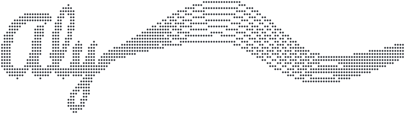

<picture>
  <source media="(prefers-color-scheme: dark)" srcset="./assets/ascii/ribbon-signature-dots-dark.svg">
  
</picture>

```nix
# $ nix eval .#aly
{
  name  = "alysson alcantara";
  work  = "seazone, since 2021";
  front = [ "react" "next.js" "ts" ];
  back  = [ "python" "django" "fastapi" ];
  os    = "nixos";
  pair  = "claude code";
}
```

Hi, I'm Aly. I build web products in Brazil, and I like the parts where a slow page or a failed payment costs real money.

```console
$ aly --help
usage: aly <topic>

  pay    checkout: 3ds, pix, paypal
  ab     a/b tests that decide what ships
  perf   fast pages on cheap phones
  ui     design systems people reuse
```

```console
$ ls ~/made
framebudget/   devproxy/   apollo-fleet/
aly.engineer/  resume.aly.engineer/
```

- [`framebudget/`](https://framebudget.dev) measures a device's frame budget before the first paint and enables only the effects that fit. 4.6 KB gzip, React, Vue and Angular bindings, MIT.
- [`devproxy/`](https://github.com/alysnnix/devproxy) one loopback IP per Docker Compose project, so ports stop colliding. Go.
- [`apollo-fleet/`](https://github.com/alysnnix/apollo-fleet) several isolated Apollo streaming hosts on one Windows box. Rust.
- [`aly.engineer/`](https://aly.engineer) my site, lab and [blog](https://aly.engineer/blog).
- [`resume.aly.engineer/`](https://resume.aly.engineer) my resume. Astro, pt-BR and en, Cloudflare Workers.

```console
$ cat ~/.now
shipping framebudget 0.9
```

[aly.engineer](https://aly.engineer) &nbsp;/&nbsp; [blog](https://aly.engineer/blog) &nbsp;/&nbsp; [resume](https://resume.aly.engineer) &nbsp;/&nbsp; [linkedin](https://linkedin.com/in/alysnnix) &nbsp;/&nbsp; [4ly.alcantara@gmail.com](mailto:4ly.alcantara@gmail.com)

```console
$ aly --langs
```

<!--START:langs-->
```text
TypeScript     4.7 MB   █████████████████████████   71.43%
JavaScript   671.6 kB   ████████████░░░░░░░░░░░░░   10.31%
Emacs Lisp   317.7 kB   █████████░░░░░░░░░░░░░░░░    4.88%
Shell        173.1 kB   ███████░░░░░░░░░░░░░░░░░░    2.66%
Nix          166.2 kB   ███████░░░░░░░░░░░░░░░░░░    2.55%
Go           159.7 kB   ██████░░░░░░░░░░░░░░░░░░░    2.45%
Python        81.3 kB   █████░░░░░░░░░░░░░░░░░░░░    1.25%
MDX           72.7 kB   █████░░░░░░░░░░░░░░░░░░░░    1.12%
```
<!--END:langs-->
